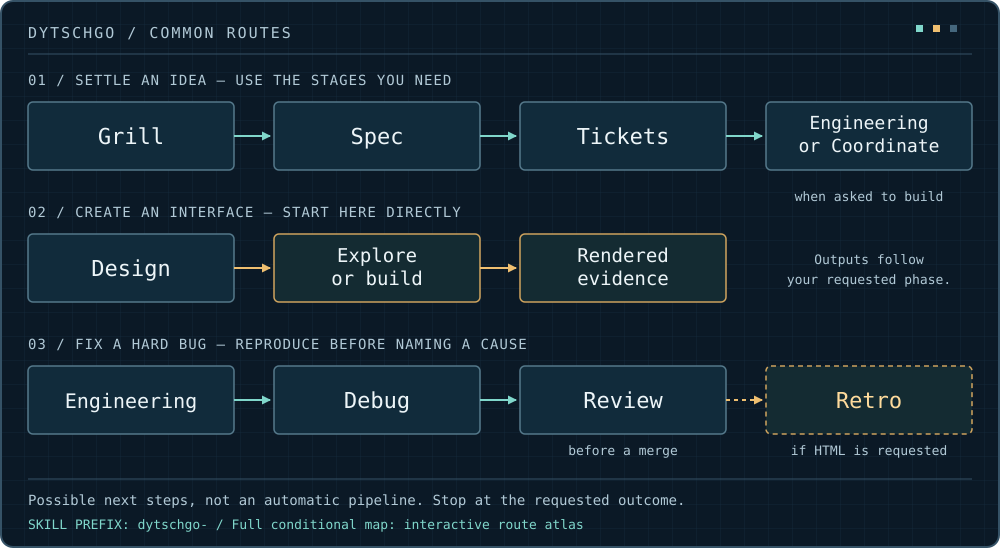

# Dytschgo Skills

16 reusable workflows for coding agents: plan a feature, build an interface, fix a bug, review a change, or explain the result.

Install the whole collection or choose the skills you need. They work with agents that support [Agent Skills](https://agentskills.io), including Codex, Claude Code, Cursor, and Gemini CLI.

## Install

You need [Node.js 22.20+](https://nodejs.org/) and a compatible coding agent. Run these commands in your terminal.

**Install all 16 skills:**

```sh
npx skills add Dytschgo/dytschgo-skills --skill '*' -g
```

Choose which agents to install to when prompted. `-g` makes the skills available across your projects.

**Install just one:**

```sh
npx skills add Dytschgo/dytschgo-skills --skill dytschgo-design -g
```

**Install a few:**

```sh
npx skills add Dytschgo/dytschgo-skills --skill dytschgo-design dytschgo-review dytschgo-retro -g
```

For a team or project-only installation, run the command from your project directory and leave out `-g`. To target an agent directly, add `-a codex`, `-a claude-code`, `-a cursor`, or `-a gemini-cli`.

Browse before installing:

```sh
npx skills add Dytschgo/dytschgo-skills --list
```

The [skills CLI reference](https://github.com/vercel-labs/skills/blob/main/docs/commands.md) covers other options and supported agents. Without that CLI, copy the desired folders from [skills/](skills/) into your agent's supported skill directory, including their contents.

## Use them in your project

Open your coding agent in the project you want to work on, then name the skill and describe the outcome. These examples use Codex's `$skill-name` syntax; use your agent's skill picker or invocation syntax elsewhere.

```text
Use $dytschgo-design to show me three dashboard directions.
Keep the same sample data in each. Stop at the mockups.
```

```text
Use $dytschgo-engineering to implement the agreed feature.
Follow this repository's patterns, verify the changed behavior,
and stop at a local change. Don't push or deploy.
```

```text
Use $dytschgo-retro to explain these changes and their evidence
in a simple interactive HTML overview.
```

No application dependency or import is needed. Skills are instructions your agent loads when relevant. They use the tools and permissions your agent already has.

## How they connect



These are example routes, not mandatory pipelines:

- **An open idea:** Grill settles decisions. Spec records them. Tickets splits larger work. Engineering or Coordinate builds when requested.
- **A website or interface:** Design can explore options or implement the selected direction. You can start here directly.
- **A hard or unclear bug:** Engineering brings in Debug to reproduce and fix it. Review checks the resulting diff before a merge.
- **An HTML explanation:** Retro presents the supplied work and evidence. A technical assessment is only added when the request needs one.

Each stage stops at your requested outcome. Installing one skill does not automatically install every skill it refers to; add a helper if your workflow needs it, or install the full collection.

For every skill and conditional connection, download [the interactive route atlas](https://raw.githubusercontent.com/Dytschgo/dytschgo-skills/main/docs/skill-atlas.html) and open it in a browser. Its [source](docs/skill-atlas.html) and [machine-readable map](docs/skill-map.json) are in this repository.

## Choose a skill

All names start with `dytschgo-`.

| Skill | Use it for |
| --- | --- |
| [design](skills/dytschgo-design/SKILL.md) | UI options, websites, implementation, and visual refinement. |
| [engineering](skills/dytschgo-engineering/SKILL.md) | Substantial cleanup, performance, implementation, and stalled work. |
| [debug](skills/dytschgo-debug/SKILL.md) | Reproducing a hard bug and proving the fix. |
| [review](skills/dytschgo-review/SKILL.md) | Checking a branch, PR, or uncommitted work against standards and the requested behavior. |
| [retro](skills/dytschgo-retro/SKILL.md) | Interactive retro HTML explanations, reviews, and maps. |
| [brief](skills/dytschgo-brief/SKILL.md) | A copyable implementation prompt from a feature idea. |
| [grill](skills/dytschgo-grill/SKILL.md) | Stress-testing an idea and settling open decisions. |
| [spec](skills/dytschgo-spec/SKILL.md) | Writing an already-settled spec as a draft or authorized tracker item. |
| [tickets](skills/dytschgo-tickets/SKILL.md) | Splitting work into ordered, verifiable slices. |
| [coordinate](skills/dytschgo-coordinate/SKILL.md) | Useful agent delegation, integration, and final acceptance. |
| [triage](skills/dytschgo-triage/SKILL.md) | Qualifying incoming issues and external PRs. |
| [impact](skills/dytschgo-impact/SKILL.md) | Checking what a change could break beyond its diff. |
| [verify-setup](skills/dytschgo-verify-setup/SKILL.md) | Creating or repairing a project's verification guide. |
| [wayfinder](skills/dytschgo-wayfinder/SKILL.md) | Mapping decisions across a large, multi-session effort. |
| [handoff](skills/dytschgo-handoff/SKILL.md) | Moving work to a fresh agent without losing decisions. |
| [agent-docs](skills/dytschgo-agent-docs/SKILL.md) | Writing skills, AGENTS.md, and other agent instructions. |

A small, clear edit can stay direct. You do not need a planning session or an agent team for every task.

## Update

For installations managed by the skills CLI, update all globally installed skills it tracks, including those from other collections:

```sh
npx skills update -g
```

Or update only selected skills:

```sh
npx skills update dytschgo-design dytschgo-retro -g
```

To refresh this collection and include newly added skills, rerun its install-all command. Use `npx skills update -p` for project installations. Restart your agent or use its skill-reload command if changes do not appear.

For manually copied installations, replace the same skill folders from the latest repository version, keeping a backup of local edits. The [maintenance guide](docs/maintenance.md) covers the Windows backup/sync script, migration from old Astra names, and optional personal profiles. It is a separate update method from the skills CLI.

## More information

- [Maintenance and contributor guide](docs/maintenance.md): backups, profiles, checks, and atlas generation.
- [Sources and attribution](SOURCES.md): upstream work and adaptations.
- [MIT license](LICENSE); bundled components retain their [upstream notices](UPSTREAM-LICENSE-PSTACK.txt) and [design-library license](skills/dytschgo-design/library/ui-ux-pro-max/LICENSE).

Installing skills does not grant permission to merge, deploy, or change accounts. Your request, project rules, and the agent's available tools still determine what it can do.
